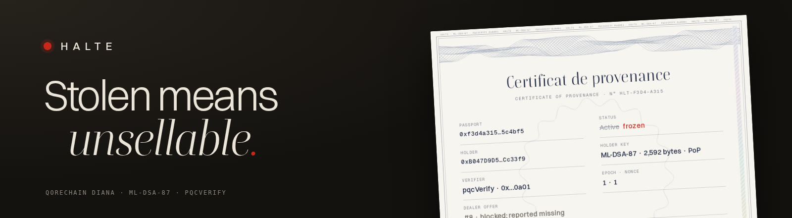
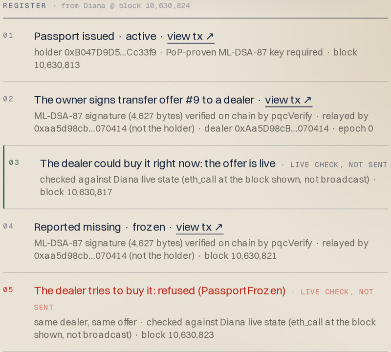
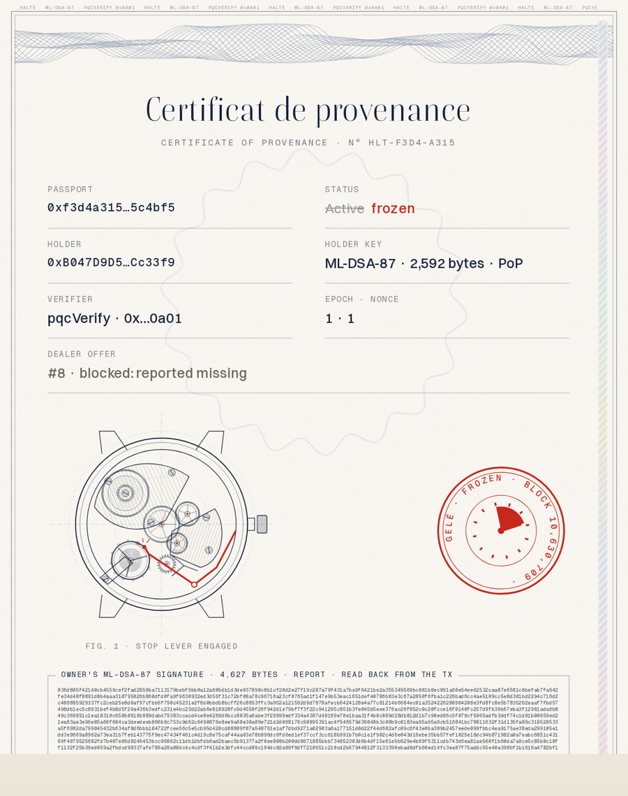

<p align="center"></p>

<h3 align="center">Report a watch missing and every open offer on its passport dies on chain. A dealer's offer from before the report stays dead even after the watch is found.</h3>

<p align="center">
  <a href="https://halte-roan.vercel.app"><b>▶ Issue a demo passport</b></a> ·
  <a href="https://halte-roan.vercel.app/p/0xbed648483ebb7c1bb1ccb005a5f858540739d25789bc21ea1547803dac915fcd?offer=2">See a finished run</a> ·
  <a href="#judges-start-here">Judges start here</a>
</p>

<p align="center">
  
  <br><em>Try it: issue a passport, have the dealer check the offer (it would go through), report the watch missing, then ask again. Same dealer, same offer: refused.</em>
</p>

Halte is a transfer passport for fine watches on QoreChain. Every action that changes who may hold the watch (offering it to a dealer, reporting it missing, lifting the report) needs the owner's ML-DSA-87 signature, and the contract checks it on chain with QoreChain's `pqcVerify` precompile against the key the owner registered with QoreChain. So a thief who steals the owner's ordinary wallet key, the kind a quantum computer is expected to break, can neither transfer the passport nor undo the report. (In the hosted demo, Halte holds the owner's key for you; see [Scope](#scope).)

The one deliberate decision: a report doesn't pause offers, it kills them. Each report moves the passport to a new epoch, so an offer arranged while the watch was missing stays dead after it's found. No sale can be "revived" once the dust settles.

No wallet, no account: the demo owner's and dealer's keys live on the Halte server so anyone can try it in a minute (see [Scope](#scope)). Every result on the page links to the transaction on QoreChain's explorer, and a shared passport link rebuilds its confirmed history from the chain in any browser.

## Judges start here

About 90 seconds, no login, works on a phone:

1. Open **[halte-roan.vercel.app](https://halte-roan.vercel.app)** and press **Issue a demo passport** → a passport is issued on QoreChain Diana and its first register line links to the transaction.
2. **The owner offers it to a dealer**, then **The dealer tries to buy it** → green: the contract would let this dealer accept now. This is the control: the offer really is live.
3. **A thief with the classical key tries to sell it** → refused, `BadPqcSignature`.
4. **Report missing** → the owner's 4,627-byte ML-DSA-87 signature is verified on chain; the receipt shows it was sent by the dealer's account, not the holder's.
5. **The dealer tries to buy it** again → same dealer, same offer: refused, `PassportFrozen`. **The owner recovers the watch**, try once more → `StaleOffer`: the old offer stays dead.

Rows marked "live check" are read-only calls against Diana's current state (nothing is sent); every other row is a real transaction.

Re-check the live claims yourself, straight from the chain: `node scripts/check-live.mjs` (Node 20+, nothing to install). Every claim with its code, test and command: [JUDGES.md](JUDGES.md).

## How it works

1. **Issue.** The owner issues a passport for a watch. The contract refuses unless the owner holds an ML-DSA-87 key registered on QoreChain with proof of possession (read from the `pqcKeyStatus` precompile), so every passport can be reported later.
2. **Offer.** The owner signs an offer to one named dealer with ML-DSA-87. Anyone may relay it; the dealer, the passport's epoch and an expiry are inside the signature, so a relayed copy can't be redirected.
3. **Report.** The watch goes missing. The owner signs a report; `pqcVerify` checks it on chain and the passport freezes. The epoch moves on, so every outstanding offer dies.
4. **Refuse.** A dealer's accept now reverts with `PassportFrozen`. A forged report, an unsigned offer or a thief's recovery reverts with `BadPqcSignature`.
5. **Recover.** Only the owner's registered key lifts the report. Offers from before it stay dead (`StaleOffer`).

<p align="center"></p>

## Built on QoreChain

| QoreChain product | what it does here |
|---|---|
| `pqcVerify` precompile (`0x…0a01`) | verifies the owner's ML-DSA-87 signature on every offer, report and recovery, inside the contract |
| `pqcKeyStatus` precompile (`0x…0a02`) | supplies each holder's registered key; Halte requires ML-DSA-87, 2,592 bytes and proof of possession, and fails closed on a malformed answer |
| ML-DSA-87 key registration (`@qorechain/sdk`) | the owner and dealer each registered a key with proof of possession |
| Scoped EVM windows (`pqc_hybrid_verify`) | every EVM write runs inside a window opened by a hybrid-signed (secp256k1 + ML-DSA-87) native transaction and limited to the Halte contract |
| QCAI audit | two stages so far, every finding answered in [docs/AUDIT.md](docs/AUDIT.md) |
| `create-qorechain-dapp` (Hardhat 3), `@qorechain/evm` | contract scaffold, window cost and status helpers |

What we added: the passport contract and its epoch rule, the signed-offer flow with a separate relayer, fail-closed decoding of both precompiles, and a web app whose register is read back from the chain.

## Proof

| claim | evidence |
|---|---|
| The contract is live on Diana | [`0x900db566…`](https://explore.qore.network/tx/B57871E8C1DF92AC1091D3C8BAF38EBB5A51D27D2850424C2A714DEBA8F38FDC) (deploy tx, block 10,611,612) · source commit `d374a16` |
| The app's runtime window is hybrid-signed and scoped to Halte only | [window tx `F44B0993…`](https://explore.qore.network/tx/F44B099360B5112ED61485A4ED76B6D776B7E55B90DB6E1CD850B497A4913B64): `pqc_hybrid_verify status=verified`, `allowed_targets=0x900db566…` |
| Before the report, the dealer could buy; during it, refused; after recovery, still refused | recorded release run on the same passport and offer: [evidence/release/0x900db566….json](evidence/release/0x900db566e46b6a68a7fd2f721b2ca6291f2ef3e4.json) (would succeed → `PassportFrozen` → `StaleOffer`) |
| The report is the owner's ML-DSA-87 signature, relayed by someone else | [freeze tx `0x3f8961…`](https://explore.qore.network/tx/3F89617ECBFC169BC416AD098439F23C7824184C9E68819C5B29AE541D53AAC9): 4,627-byte signature in the call, sender is the dealer account |
| A stolen classical key can't list the watch | `makeOffer` from the holder's own address with no ML-DSA-87 signature → `BadPqcSignature` (re-checked live by `check-live.mjs`) |
| A real handoff works | [accept tx `0x99698c…`](https://explore.qore.network/tx/99698CF12CC93134DF41B282EA752CC9A9DB2FF77245E98097037203006BE218): the passport moved to the dealer through an owner-signed offer |
| The journey passes on the live site, at phone width, logged out | [evidence/status/latest.json](evidence/status/latest.json) (`node scripts/status.mjs`) |
| 21 contract tests: wrong keys, replay, expiry, ordering races, key rotation, malformed precompiles | [evidence/tests/halte-tests.txt](evidence/tests/halte-tests.txt) · [contracts/test/Halte.ts](contracts/test/Halte.ts) |

<details>
<summary><b>Run it yourself</b></summary>

Contract (Hardhat 3, Node 22):

```bash
cd contracts && npm install
npx hardhat test                       # 21 tests against a mock of the two precompiles
cp .env.example .env                   # QORE_MNEMONIC of a funded Diana account
npx tsx --env-file=.env scripts/window.ts register   # ML-DSA-87 key with proof of possession
npx tsx --env-file=.env scripts/window.ts open       # hybrid-signed, scoped EVM window
npx tsx --env-file=.env scripts/release-proof.ts 0x900db566e46b6a68a7fd2f721b2ca6291f2ef3e4
```

Web app (Next.js 15):

```bash
cd web && npm install
# .env.local: QORE_MNEMONIC (account 0 = owner, 1 = dealer), KV_REST_API_URL + KV_REST_API_TOKEN (Upstash Redis)
npm run build && npm start
```

| path | what |
|---|---|
| `contracts/contracts/Halte.sol` | the passport contract |
| `contracts/test/Halte.ts` | the tests |
| `contracts/scripts/` | key registration, windows, funding, the release proof run |
| `web/lib/chain.ts` | signing, windows, sending and exact refusal decoding |
| `web/lib/guard.ts` | signer lock, idempotency, rate limits, holder access |
| `web/lib/history.ts` | the register, rebuilt from the contract's events |
| `checks/journey.mjs`, `scripts/status.mjs` | the journey, checked against the live site and the chain |
| `scripts/check-live.mjs` | the judges' re-check |
| `docs/AUDIT.md`, `docs/audit/` | QCAI reports and responses |
| `docs/review/` | the build's adversarial review by two AI models, and what was changed |

</details>

## Scope

- **Testnet only.** Everything runs on QoreChain Diana (chain 9800). No real watches or money.
- **Demo custody.** The owner's and dealer's ML-DSA-87 keys are held by the Halte server so judges need no wallet. The dealer's account also relays the owner's signed messages, which is why receipts show a sender who isn't the holder. A passport can only be changed from the browser that issued it (a key in its link); anyone else sees it read-only.
- **Limits.** Three demo passports per visitor every ten minutes and a daily cap, so the shared signer can't be drained. If the signing lock is unreachable, the site goes read-only and points to the recorded run.
- **What a report can't do.** It stops transfers of the passport; it doesn't track the watch, and the demo has no way to prove who really owns a physical watch at issue time.
- **Audit.** QCAI stages 1 and 2 scored 75 and 85 out of 100 on earlier source; the release contract adds signed offers and the epoch bump on transfer, and its own QCAI run is pending. Details in [docs/AUDIT.md](docs/AUDIT.md).
- **Tested on** Chrome desktop and Android Chrome.

Built for **Build Before Q-Day, the QoreChain Developer Fest** · Post-Quantum dApp track · built with AI coding assistants (Claude Code, with Codex as a second reviewer) · contract scaffold from `create-qorechain-dapp`; fonts Switzer and Boska from Fontshare · [Apache-2.0](LICENSE)
